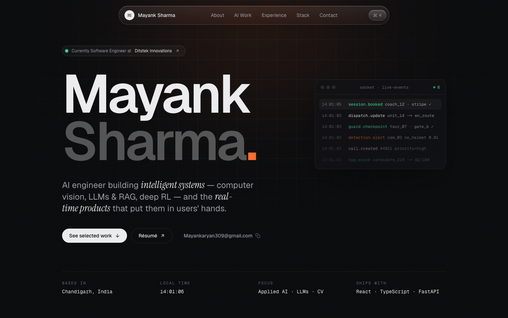

# Mayank Sharma — AI & Software Engineer

Personal portfolio of Mayank Sharma: applied AI (computer vision, LLMs/RAG, deep RL) and the real-time React/TypeScript products that ship it.

**Live:** https://mayank-developer-portfolio.vercel.app



## Sections

Hero (live event console) → About (bento) → Selected AI work → Experience → Stack & credentials → Contact.
Press <kbd>⌘</kbd>/<kbd>Ctrl</kbd> + <kbd>K</kbd> anywhere for the command palette.

## Stack

Next.js 15 (App Router) · React 19 · Tailwind CSS 3.4 · SCSS · Nodemailer · react-icons · react-toastify. Deployed on Vercel.

## Run locally

Requires Node.js 18.18+ (20 LTS recommended).

```bash
npm install
cp .env.example .env   # fill in the values (see below)
npm run dev            # http://localhost:3000
```

Production check: `npm run build && npm start`.

With Docker: `docker compose up --build dev` (port 3000) or `docker compose up --build prod` (port 3005).

## Editing content

All content lives in `utils/data/`, so components rarely need touching:

| File | Contents |
| --- | --- |
| `personal-data.js` | Identity, links, summary, hero stats |
| `experience.js` | Jobs (with client products) and education |
| `projects-data.js` | Featured AI projects (`visual`: `cctv` / `rag` / `traffic`) and smaller builds |
| `skills.js` | Skill groups, marquee, research paper, certifications |

To update the résumé, replace `public/Mayank_Sharma_Resume.pdf`.

## Contact form

`app/api/contact/route.js` emails each message via Gmail (reply-to is the sender) and optionally pings Telegram. It succeeds if either channel delivers.

| Variable | Purpose |
| --- | --- |
| `EMAIL_ADDRESS` | Gmail account that sends and receives messages |
| `GMAIL_PASSKEY` | Gmail [App Password](https://myaccount.google.com/apppasswords) (requires 2FA) |
| `TELEGRAM_BOT_TOKEN` | Optional, from [@BotFather](https://t.me/botfather) |
| `TELEGRAM_CHAT_ID` | Optional, chat that receives the ping |
| `NEXT_PUBLIC_GTM` | Optional Google Tag Manager ID |

Never commit `.env`; keep `.env.example` blank.
